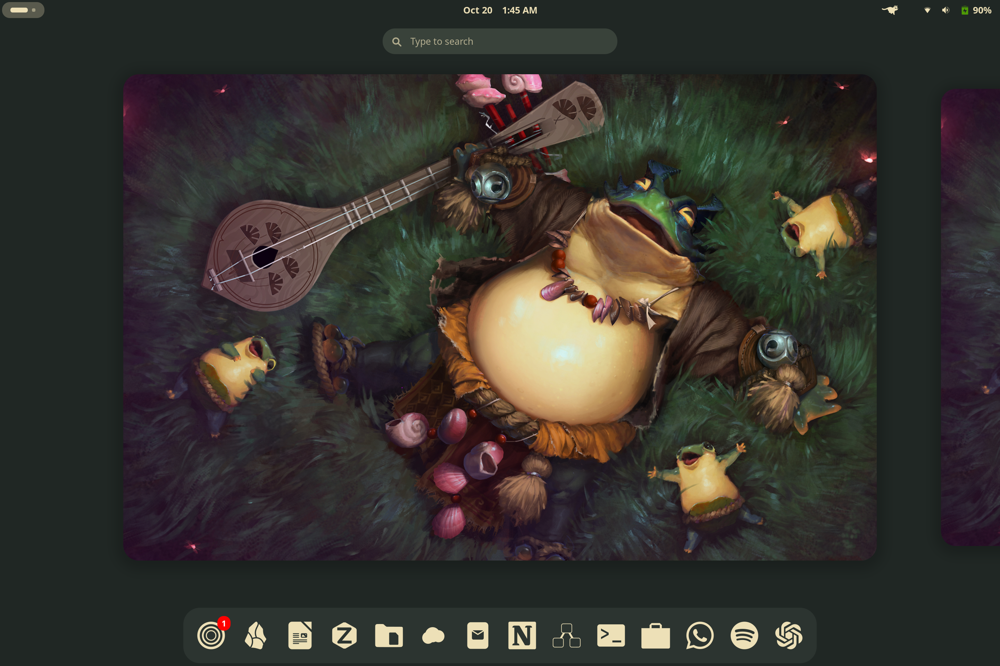

# Project Largo · Alpha 1

**One stop to make Gnome truly yours.**

Project Largo is a native & unified theming engine for the Gnome Desktop.

Packaged with **18 dark palettes**, stock **GNOME Light/Dark** presets, coordinated icons and wallpapers, and a **Set up / Refresh integrations** button for supported applications.



**Version:** `0.1.0-alpha.1` · **Target:** Fedora 44 / GNOME Shell 50 ·
**Distribution:** private Alpha source build

## Start here

1. **[Download Alpha 1](https://github.com/buffakee/project-largo-alpha/releases/tag/v0.1.0-alpha.1)**
   — use the attached source kit and `SHA256SUMS`, or clone this repository.
2. **[Follow the first-install guide](GETTING_STARTED.md)**
   — prerequisites, installation, first palette and application setup.
3. **[Understand app statuses](INTEGRATIONS.md#status-meanings)**
   — including apps that need opening once, closing or restarting.
4. **[Recovery and removal](RECOVERY.md)**
   — stock appearance, previous palette and backed-up settings.

Repository access is required while this Alpha is private.

## What you get

- A native palette picker: Apply, Previous palette and integration setup.
- GNOME Shell and GTK colors, with the native GNOME layout retained.
- Palette-foreground-colored **YAMIS icons** and **Bibata Modern Ice** by default;
  cursor size and later appearance choices are preserved.
- **54 associated wallpapers**, **17 supplied theme defaults** and per-preset
  wallpaper memory. Solarized keeps your current background.
- Reversible Vanilla GNOME Light/Dark modes.
- Rescannable app enrollment with individual results, backups and restoration.

## Maintained integration setup

| Application | Alpha setup scope |
| --- | --- |
| LibreOffice | Native and Flatpak profiles; executable discovery, color extension verification, scheme selection and supported GTK3 desktop launch routes. |
| Zen | Registered native/Flatpak profiles; stylesheet loading/imports and native workspace gradient references. |
| Obsidian | Registered native/Flatpak vaults; enables the palette snippet using only `.obsidian` configuration/snippets. Personal notes are never read or changed. |
| Zotero | Native UI styles and the existing local PDF bridge. Zotero Flatpak is outside maintained scope. |
| GDM | Optional, separate administrator-authenticated setup for GNOME 50. No login-manager or session restart. |

Missing optional applications are normal. Install an app later, open it once,
close it and run setup again. Once enrolled, ordinary palette switching updates
its integration; some clients need reopening or deferred work while closed.
See [integration details](INTEGRATIONS.md) for exact behavior and verification.

## Compatibility

- **GNOME Shell 50** is required by the current Shell adapter.
- Install the compatible **User Themes** GNOME extension.
- Keep the native [Noctalia renderer](https://github.com/noctalia-dev/noctalia)
  dependency. Niri, a running Noctalia shell and Noctalia user settings are **not
  required** for GNOME setup. The similarly named QML shell is a different project.
- This is a user-local **source installation**, not an RPM, Flatpak or standalone
  binary. Other distributions and non-default XDG layouts remain unverified.

The build passed **50 unit tests**, all **18 native palette/CSS checks**, isolated
appearance recovery, headless GTK controls, **36 GDM stylesheet parses**, and real
native LibreOffice enrollment/restoration in a disposable profile. Real Flatpak
enrollment, clean-VM interactive application startup/visuals and actual GDM login
behavior still need verification. [Full Alpha notes](ALPHA_NOTES.md).

## Useful commands

```bash
~/.local/bin/project-largo pick
~/.local/bin/project-largo integrations status --json
~/.local/bin/project-largo integrations setup
~/.local/bin/project-largo integrations repair --app libreoffice
~/.local/bin/project-largo wallpaper-default
```

`wallpaper-default` explicitly restores the active custom preset's supplied
wallpaper; it reports when no default exists. Reinstallation retains later
cursor/icon choices and wallpaper memory.

## More information

- [Advanced reference and manual integrations](REFERENCE.md)
- [Development and tests](DEVELOPMENT.md)
- [Changelog](CHANGELOG.md)
- [Alpha packaging/publishing](PUBLISHING.md)
- [Report an Alpha issue](https://github.com/buffakee/project-largo-alpha/issues/new)

This new-user-focused repository starts from the current first-run build of
[Project Largo](https://github.com/buffakee/project-largo). Runtime code and assets
are preserved; `UPSTREAM_SNAPSHOT.json` records the source snapshot hashes.
The two repositories use the same application IDs and install paths.

## License and credits

Original Largo code is **GPL-3.0-only**, copyright © 2026 buffakee. Bundled palettes,
templates and artwork retain their original notices. See [LICENSE](LICENSE),
[THIRD_PARTY.md](THIRD_PARTY.md) and [appearance asset notes](assets/appearance/README.md).
